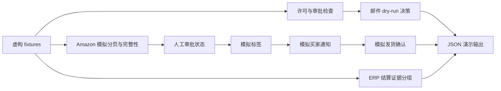

# Commerce Operations Lab

**从 0 到 1：邮件审批、Amazon 订单、物流编排与 ERP 对账的离线工程作品。**

[](https://github.com/LUCIENIN/commerce-operations-lab/actions/workflows/ci.yml)

运营中最难的不是调用一次接口，而是回答：这封邮件是否获得许可？分页是否完整？标签是否对应正确订单？状态不确定时可否重试？同一结算中的两笔交易是否真的存在因果关系？

本项目将真实工作流中观察到的这些问题重新建模为一个**可运行、可测试、无业务数据**的模块化作品。公开代码由 AI 辅助重新编写；没有复制生产源代码或历史。作者：[LUCIENIN](https://github.com/LUCIENIN)。它是工程设计与验证的演示，不代表公开了整个生产 ERP，也不把生产代码存在等同于本次已验证线上运行。

## 30 秒运行

Python 3.11+，仅标准库，无需安装依赖、账号或密钥。在仓库根目录运行：

```sh
python3 -m ops_lab.demo
python3 -m unittest discover -s tests -v
python3 scripts/publication_scan.py
```

预期结果：

- 邮件：一个 `dry_run:planned`、一个 `held:consent`、一个 `held:suppressed`。
- Amazon：读取两个模拟分页，去重后两笔虚构订单，`complete: true`。
- 物流：审批 → 模拟标签 → 模拟通知 → `confirmation_simulated`，保留顺序审计记录。
- ERP：按准确结算标识分组，缺失标识进入 `unassigned`，利润保持 `null`，采集不完整时显式标记。

[完整示例输出](docs/demo-output.json) · [架构与边界](docs/architecture.md) · [真实实现依据](docs/capability-matrix.md) · [测试与发布](docs/verification.md) · [简历描述](docs/resume-zh.md)

## 数据流



## 从问题到可演示系统

1. **梳理边界**：从只读源码、既有测试和本地知识索引识别邮件、订单、物流与对账职责；不运行生产入口。
2. **建立模型**：分开审批证据、查询完整性、操作状态和结算证据，避免用单个“成功”掩盖中间失败。
3. **构建最小闭环**：将新编写的策略、采集、状态机、对账模块连接到虚构 fixture，生成确定性输出。
4. **验证负面路径**：公开邮箱不代表同意；不完整订单不能推进；通知先于确认；不确定结果进入人工审阅；分页权限失败停止。
5. **交付可核验作品**：全新 Git 历史、可运行命令、CI、发布扫描、能力边界与可复用简历描述。

## 功能状态

| 模块 | 本仓库可运行能力 | 真实系统只读检查发现 | 本次未验证或未提供 |
|---|---|---|---|
| 邮件 | 许可范围/期限、内容摘要审批、抑制、去重、120 秒间隔、200/日模拟上限 | Swift 审批邮件器、批次验证、SMTP/IMAP 与不确定状态隔离代码 | 真实发送、持久队列、钥匙串、调度器 |
| Amazon | 分页、循环检测、页数预算、权限失败、去重与完整性 | SP-API 订单/商品/财务采集脚本和客户端 | 真实账号调用、广告 API、平台认证 |
| 物流 | 审批、模拟标签/通知/确认、进程内幂等和审计 | 承运商客户端、标签、消息与确认编排及相关测试 | 创建运单、真实标签、库存/订单写入 |
| ERP | 准确结算标识分组、缺失证据保留、未知利润 | Web 工作台、运营状态合并、对账工具 | 全自动 ERP、完整会计/采购/仓储系统 |

120 秒与 200/日来自原流程的自设保护，不是服务商许可额度或送达承诺。原服务商 REG.RU 禁止未经许可的广告群发；本仓库不提供规避限制的方法，公开邮箱不构成同意。所有联系人使用 `example.invalid`，许可凭证同样是虚构示例。

## 重要局限

所有状态和去重只在本进程中生效，重启将重置。摘要审批展示内容绑定，不是身份认证或数字签名。审计列表可修改，不是防篡改日志。模拟时钟采用 UTC 秒，不实现生产收件人时区和夏令时。`external_operations: 0` 是演示描述，测试与源代码检查共同验证其边界。

没有真实邮件正文、客户/员工资料、订单号、金额、附件、配置、凭据、机器路径或服务器地址。没有接入生产。没有声称实现每周 4000 封、广告 API 或全自动 ERP；这些不应写为已完成成果。

## 演进路线

- 引入事务存储、并发锁、跨重启幂等及可验证审批身份。
- 加入故障注入与不确定提交后的人工对账流程。
- 经独立授权、隐私及接口合同评审后，另建隔离集成环境；本仓库持续保持离线。
- 分阶段补齐仓储、成本账本、财务对账与权限模型，用实际验收证据决定功能状态。

新编写演示代码采用 [MIT License](LICENSE)。没有包含第三方源代码或依赖；商标名称仅用于说明集成背景，不表示官方合作或认证。
